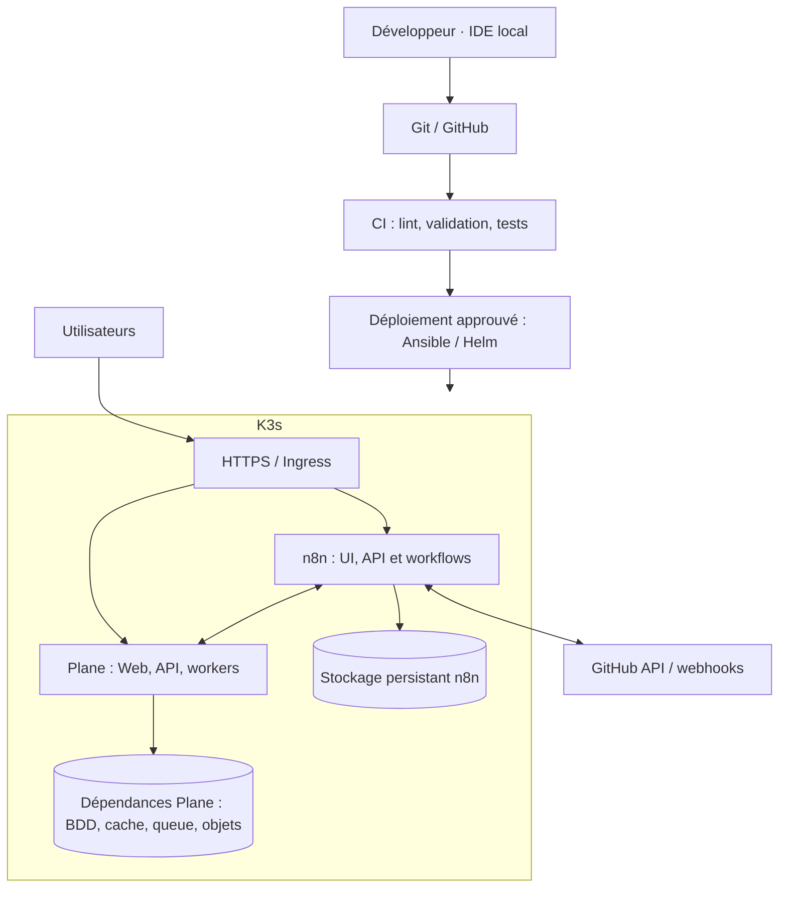

# Project OS

**Une plateforme DevOps auto-hébergée pour organiser des projets, centraliser la documentation et automatiser les workflows GitHub.**

Project OS est un projet d'infrastructure **Infrastructure as Code (IaC)** visant à déployer et exploiter, sur un cluster **K3s single-node**, une plateforme de gestion de projets reposant sur **Plane** et **n8n**. L'objectif est de disposer d'un environnement personnel, éventuellement partagé avec une petite équipe (environ 5 à 7 personnes), et de pratiquer Kubernetes, Helm, Ansible, GitOps, réseau, stockage, sauvegardes et observabilité.

> **État au 2026-10-31 :** **K3s `v1.37.1+k3s1` est installé** par le rôle Ansible sur la VM KVM (Ubuntu 24.04.5). Nœud `Ready`, Pods système sains, StorageClass `local-path`. TCP 6443 et 10250 restent filtrés depuis Internet alors que K3s écoute. Smoke test réussi (DNS, trafic inter-Pods, PVC, sortie Internet des Pods). Redémarrage et idempotence vérifiés ; Traefik, cert-manager et Let's Encrypt (HTTP-01, sslip.io provisoire) fonctionnels. Restent à faire : sauvegarde K3s, puis Plane et n8n. Plane et n8n ne sont pas déployés.

## Objectifs

- Héberger une instance Plane pour les projets, tickets, cycles et documentation.
- Automatiser les workflows avec n8n : événements Plane et GitHub, création et routage des tâches vers des backlogs adaptés (ex. `frontend` / `backend`).
- Déployer et mettre à jour les applications de façon **déclarative**, à partir de fichiers versionnés.
- Garantir HTTPS, authentification, persistance des données, sauvegardes et restauration testée.
- Garder un environnement sobre, économique et maintenable sur un seul VPS, sans prétendre à la haute disponibilité.

## Architecture cible



*Le diagramme est conceptuel : les composants précis et les dépendances seront déterminés à partir des charts et de leurs versions validées. Plane embarque déjà son backend et ses workers : **nous n'écrivons pas un backend Plane personnalisé**.*

## Stack envisagée

| Domaine | Choix | Notes |
|---|---|---|
| Orchestration | K3s | 1 nœud au départ ; VM KVM, compatibilité à tester réellement |
| Provisionnement | Ansible | Installation et configuration de K3s à partir de l'IDE |
| Déploiement applicatif | Helm | Charts officiels ou maintenus, versions épinglées |
| Gestion de projets | Plane Community Edition | Chart officiel `plane-ce` retenu pour la V1 ; compatibilité réelle à valider avant installation |
| Automatisations | n8n | Workflows GitHub ↔ Plane ; sauvegarder configurations et credentials |
| Entrée HTTP/HTTPS | Traefik ou Ingress compatible | DNS et TLS à définir ; exposition publique minimale |
| Données | PostgreSQL et services requis par les charts | PVC, stratégie de sauvegarde et restauration |
| CI / GitOps | GitHub Actions, puis éventuellement Flux ou Argo CD | Pas de déploiement automatique sensible par défaut |
| Observabilité | Logs, métriques, alertes | Ajouter progressivement selon les ressources |

## Environnement cible connu

| Ressource | Observation (2026-10-30) |
|---|---|
| OS | Ubuntu 24.04.5 LTS, noyau `6.8.0-147-generic`, x86_64 |
| Hébergement | **VM KVM** (`systemd-detect-virt`) ; auparavant conteneur LXC |
| CPU | 9 vCPU |
| RAM | ~11 Gio visibles |
| Disque | 137 Go, ~123 Go libres |
| Cgroups | v2, contrôleurs CPU et mémoire présents |
| Modules | `overlay`, `br_netfilter`, `vxlan` disponibles, non chargés |
| Réseau | IPv4 publique ; `ip_forward=0` (défaut Ubuntu) ; `/proc/sys` en écriture |
| TUN | `/dev/net/tun` présent |
| Pare-feu | UFW actif, `INPUT DROP`, seul TCP 22 autorisé ; Fail2ban actif |
| Kubernetes | Aucun binaire, service ni répertoire K3s/kubelet/containerd |

**Prérequis partiels, pas une certification de compatibilité K3s.** Les tests containerd, CNI, Pods, DNS et PVC doivent encore être effectués. Le mode réseau de Flannel (`vxlan`, `host-gw` ou autre) sera retenu après essais contrôlés : ne pas le considérer comme acquis.

## Séparation des responsabilités

**AegisOps**, projet indépendant, a déjà servi à préparer et durcir le VPS (comptes administrateurs, SSH, protections système). **Project OS ne refait pas ce hardening.** Il gère l'installation et l'exploitation de Kubernetes et des applications. Toute règle réseau nécessaire à K3s doit être documentée, limitée et coordonnée avec la politique de sécurité existante.

## Organisation du dépôt (cible, à adapter à l'existant)

```text
Project-OS/
├── README.md
├── AGENTS.md
├── .gitignore
├── docs/
│   ├── architecture.md
│   ├── deployment.md
│   └── recovery.md
├── infrastructure/
│   └── ansible/
│       ├── ansible.cfg
│       ├── inventories/production/hosts.example.yml
│       ├── playbooks/
│       │   ├── prerequisites.yml
│       │   └── install-k3s.yml
│       └── roles/k3s/
├── kubernetes/
│   ├── namespaces/
│   ├── ingress/
│   ├── plane/
│   └── n8n/
├── helm/
│   ├── plane-values.example.yaml
│   └── n8n-values.example.yaml
├── scripts/
│   └── validate.sh
└── .github/workflows/
    └── ci.yml
```

Il s'agit d'une **structure proposée**, pas de fichiers déjà implémentés. Ne créer que les éléments nécessaires à la phase courante.

## Roadmap

Le suivi détaillé de la phase active et les commandes de précheck sont dans
[docs/phase-1.md](docs/phase-1.md).
L'[état de reprise](docs/reprise.md) rassemble les décisions, les blocages et
les prochaines étapes avant tout déploiement.

Les playbooks K3s préparés et leurs verrous de déploiement sont décrits dans
[docs/k3s-playbooks.md](docs/k3s-playbooks.md).
La procédure d'installation sur la VM, avec ses commandes et son retour arrière,
est dans [docs/install-k3s-vps.md](docs/install-k3s-vps.md).
Le choix DNS provisoire (sslip.io) et cert-manager sont décrits dans [docs/tls.md](docs/tls.md). Aucun déploiement K3s n'a été
effectué par Project OS ; l'installation annoncée par l'administrateur reste
à inspecter.

La comparaison et le choix de Plane Community Edition pour la V1 sont dans [docs/plane-editions.md](docs/plane-editions.md)
et la préparation n8n dans [docs/n8n.md](docs/n8n.md). Les versions des charts
sont épinglées dans [helm/charts.lock.yaml](helm/charts.lock.yaml).
Les contrats de Secrets et le plan de restauration sont dans
[docs/secrets.md](docs/secrets.md) et [docs/recovery.md](docs/recovery.md).

- [ ] **1 — Socle IaC :** dépôt, conventions, inventory exemple, validation de syntaxe, tests de compatibilité de l'hôte en lecture seule.
- [ ] **2 — K3s :** installation contrôlée et reproductible ; API Kubernetes non exposée publiquement ; tests du nœud, DNS, réseau des Pods, stockage et redémarrage.
- [ ] **3 — Accès / stockage :** Ingress, DNS/TLS, StorageClass/PVC, Secrets, sauvegarde et restauration minimale.
- [ ] **4 — Plane :** installer le chart Community Edition retenu ; valider UI, API, workers et persistance.
- [ ] **5 — n8n :** installation, persistance, chiffrement des credentials, webhooks et workflows GitHub ↔ Plane.
- [ ] **6 — Exploitation :** métriques, alertes, mises à jour, CI et éventuellement GitOps ; tests de restauration.

## Workflow de développement

1. **Coder localement** dans l'IDE ; ne pas éditer directement les fichiers applicatifs sur le VPS.
2. **Versionner** les templates, manifests et fichiers de valeurs non secrets.
3. **Valider** YAML, Ansible, Helm et Kubernetes localement et en CI quand disponible.
4. **Examiner le diff**, les permissions, les ports ouverts et l'impact sur les données.
5. **Déployer explicitement** sur le VPS de test/production, après approbation pour toute opération sensible.
6. **Vérifier** la santé, la connectivité, les données persistantes et les sauvegardes.

Les commandes exactes d'installation seront documentées **après** validation du premier playbook et du réseau K3s. Ne pas exécuter un script d'installation distant au hasard.

## Sécurité et sauvegardes

- L'API Kubernetes (TCP 6443) ne doit **pas** être accessible publiquement. Utiliser un accès local, un tunnel SSH ou un chemin d'administration privé et contrôler le filtrage **avant** de lancer K3s.
- Le VPS possède une IPv4 publique. Garder SSH, les règles Fail2ban et les protections mises en place par AegisOps ; ne pas réinitialiser iptables/nftables/UFW.
- Ne jamais committer : kubeconfig, tokens de jointure K3s, mots de passe, clés privées, `Secret` Kubernetes en clair, fichiers `.env` réels ou credentials n8n.
- Employer Ansible Vault, un mécanisme de secrets chiffrés ou une solution équivalente adaptée à la V1.
- Épingler les versions d'images/charts ; éviter `latest` en production.
- Sauvegarder les volumes, bases de données et fichiers de configuration ; tester **la restauration**.
- Éviter les expositions publiques des dashboards, bases, files de messages et endpoints d'administration.
- Le VPS est **single-node** : une panne de l'hôte interrompt toute la plateforme. Ce projet ne revendique pas de haute disponibilité.

## Critères de réussite V1

Une V1 est livrable lorsque K3s est sain, que Plane et n8n fonctionnent sous HTTPS, que les données survivent à un redémarrage, qu'un workflow GitHub ↔ Plane est vérifié, que l'API Kubernetes est protégée, que la restauration a été testée et que le déploiement est reproductible depuis Git.

## Documentation de référence

- [K3s — Documentation](https://docs.k3s.io/)
- [K3s — Configuration](https://docs.k3s.io/installation/configuration)
- [Plane — Self-hosting](https://developers.plane.so/self-hosting/overview)
- [Plane — Kubernetes](https://developers.plane.so/self-hosting/methods/kubernetes) — documentation des charts Community et Commercial ; la V1 vise Community.
- [n8n — Self-hosting](https://docs.n8n.io/hosting/)

## État actuel

**Phase active :** préparation de l'installation K3s sur la VM KVM : modules et forwarding IPv4 à activer de façon versionnée, interaction avec UFW à décider, puis installation approuvée et smoke tests. Voir [docs/phase-1.md](docs/phase-1.md).
