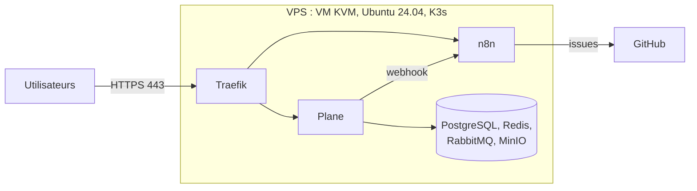

# Project OS

Plateforme de gestion de projets auto-hébergée, décrite entièrement dans ce dépôt.

- **Plane** : projets, tickets, cycles, documentation.
- **n8n** : automatisations GitHub ↔ Plane.
- **K3s** : le cluster Kubernetes qui fait tourner le tout, sur un seul VPS.

Tout s'installe depuis ton poste avec **Ansible**. Rien ne se modifie à la main sur le serveur.

## État actuel

| Brique | État |
|---|---|
| K3s | ✅ Installé et testé |
| HTTPS (Traefik + Let's Encrypt) | ✅ Fonctionne |
| Plane | ✅ En ligne (v1.4.2), compte admin créé |
| n8n | ✅ En ligne (v2.44.5), compte propriétaire créé |
| Sauvegardes | ✅ Plane et n8n, restaurations testées. Copie hors poste et automatisation à faire. |
| Workflow Plane → GitHub | ✅ En service, avec traduction FR → EN (DeepL) |

Détails et historique : [docs/00-etat.md](docs/00-etat.md).

## Par où commencer

Suis les guides dans l'ordre :

1. [Préparer ton poste](docs/01-poste-local.md)
2. [Installer K3s](docs/02-k3s.md)
3. [Activer HTTPS](docs/03-https.md)
4. [Déployer Plane](docs/04-plane.md)
5. [Déployer n8n](docs/05-n8n.md)
6. [Workflow Plane → GitHub](docs/06-plane-github.md)

À connaître aussi :

- [Secrets](docs/secrets.md) : où ils sont et comment ils sont créés.
- [Sauvegardes](docs/sauvegardes.md) : quoi sauvegarder.
- [Choix techniques](docs/decisions.md) : ce qu'on a choisi, et pourquoi.
- [Reprendre l'historique ClickUp](docs/07-import-clickup.md) : fait (2026-11-06).
- [Générer le PLD](docs/08-pld.md) : `./scripts/generer-pld.sh 2` → Word + Excel + rapport de cohérence. [Plan](docs/plan-pld.md).
- [Console web du VPS](docs/plan-console.md) : plan (supervision + génération du PLD).
- [AGENTS.md](AGENTS.md) : contexte et règles pour les agents IA (Codex, Claude Code…).

## Architecture



Seuls les ports **22** (SSH), **80** et **443** sont ouverts sur Internet.

## Règles à respecter

1. **Aucun secret dans Git** : mots de passe, kubeconfig, IP du serveur, clés.
2. **Tout passe par le dépôt** : on modifie un fichier, on valide, on applique avec Ansible.
3. **On ne touche pas** à SSH, aux comptes, à Fail2ban ni aux règles existantes du pare-feu : c'est le rôle du projet AegisOps.
4. **L'API Kubernetes (port 6443) reste fermée** sur Internet.
5. **Sauvegarder avant** toute mise à jour.

## Contenu du dépôt

```text
infrastructure/ansible/   Rôle K3s, playbooks, inventaires d'exemple
kubernetes/               Manifests (cert-manager, tests)
helm/                     Valeurs Helm et versions épinglées
n8n/                      Workflows n8n à importer et leurs tests
scripts/                  Validation, tests, génération des secrets
docs/                     Guides
```

## Vérifier avant de committer

```bash
./scripts/validate.sh
```
